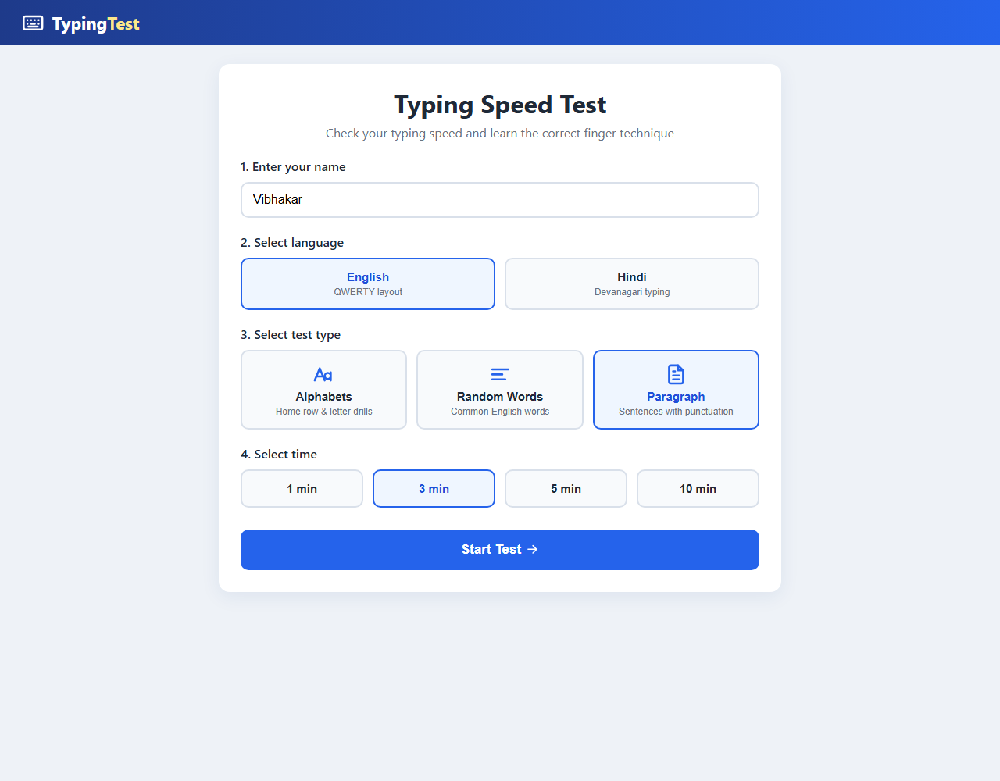
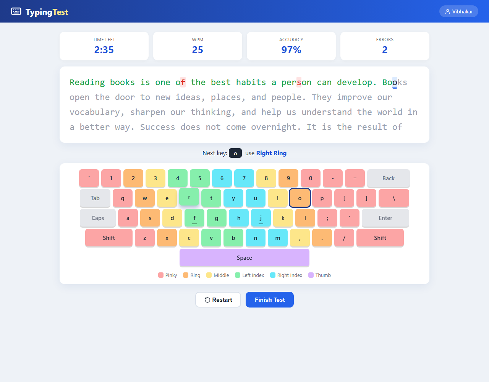
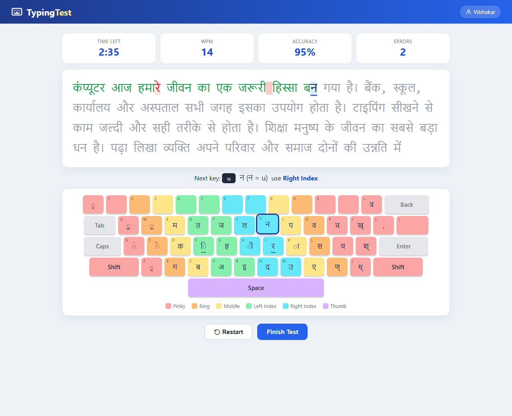
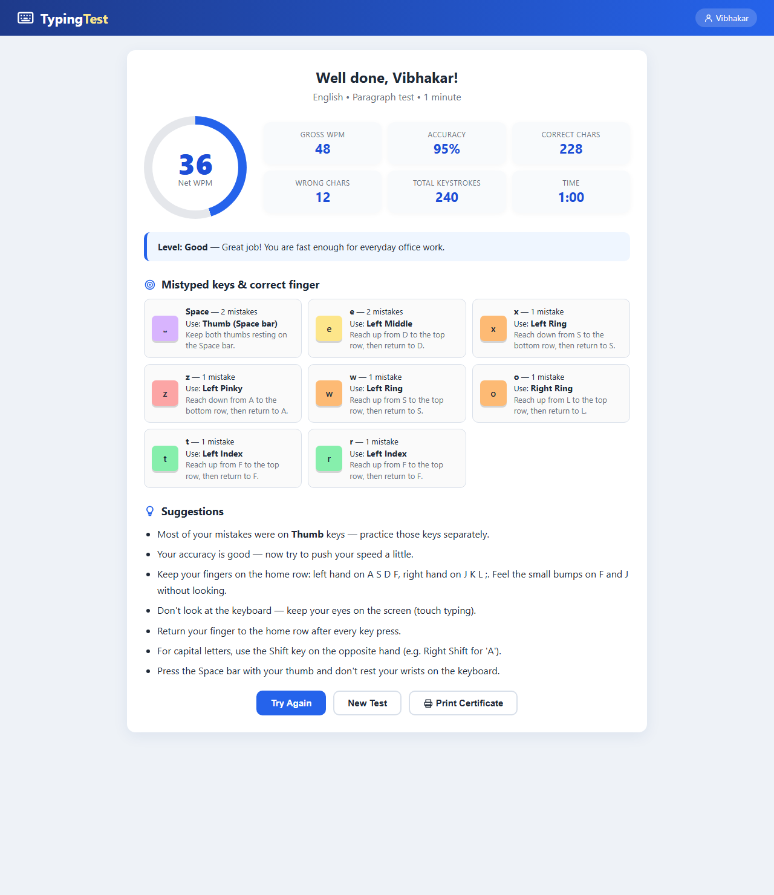
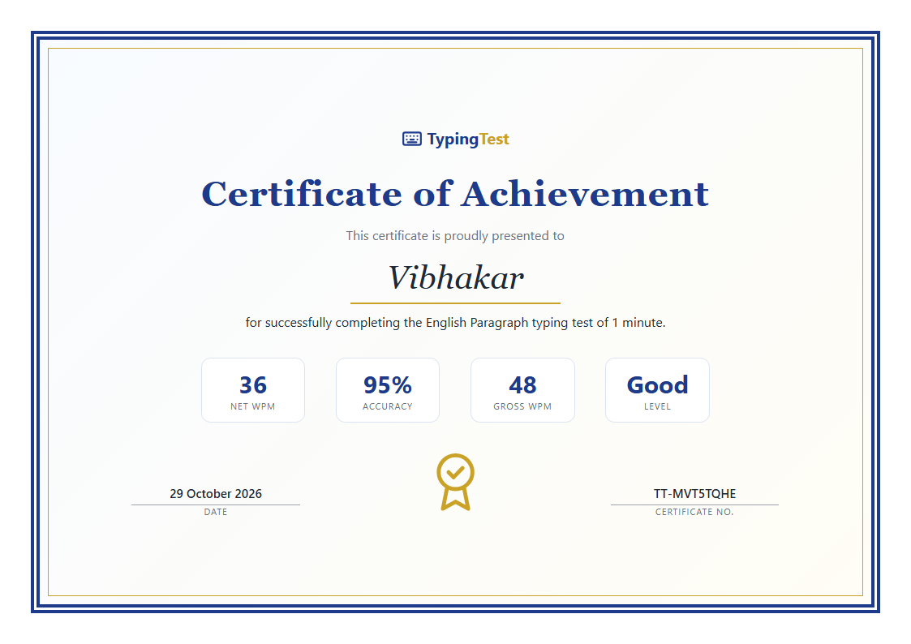

# TypingTest

A lightweight typing speed test that runs entirely in the browser. Pick a language, a test type and a duration, type the text on screen, and get your WPM, accuracy and finger-by-finger suggestions on which keys to practise. You can also print a certificate of your result.

Built with plain **HTML, CSS and JavaScript** — no frameworks, no build step, no internet connection needed.



## Features

- **Two languages** — English (QWERTY) and Hindi (Kruti Dev keyboard layout, shown in standard Devanagari, so no special font is needed)
- **Three test types** — Alphabets (letter drills), Random Words, and Paragraphs
- **Four durations** — 1, 3, 5 or 10 minutes; the timer starts on your first keystroke
- **Live stats** — time left, WPM, accuracy and errors while you type
- **On-screen keyboard** — colour-coded by finger, highlights the next key (and the Shift key when needed)
- **Finger guide** — shows which finger to use for the next key
- **Detailed result** — net and gross WPM, accuracy, correct/wrong characters, keystrokes and a skill level
- **Weak-key analysis** — the keys you missed most, with the correct finger and how to reach each key from the home row
- **Personal tips** — based on your accuracy, speed and the finger that made the most mistakes
- **Printable certificate** — with your name, scores, date and a certificate number (print or save as PDF)

## Screenshots

### Typing — English


### Typing — Hindi
Hindi text is shown in Devanagari, while you type with Kruti Dev keys. The hint shows the key, the sign it types and the full key sequence for the current letter (for example `कि = f d`).



### Result


### Certificate


## Getting started

```bash
git clone https://github.com/iamvibhakar/typingTest.git
cd typingTest
```

Then open `index.html` in any modern browser (Chrome, Edge, Firefox). That's it — nothing to install.

> On a phone or tablet the app works with the on-screen keyboard, but a physical keyboard is recommended.

## How it works

### Scoring

| Metric | Formula |
|---|---|
| Gross WPM | (characters typed ÷ 5) ÷ minutes |
| Net WPM | Gross WPM − (uncorrected wrong characters ÷ minutes) |
| Accuracy | correct keystrokes ÷ total keystrokes × 100 |

A "word" is the standard 5 characters (keystrokes for Hindi). Fixing a mistake with Backspace removes it from the net WPM penalty, but it still counts against accuracy.

### Levels

| Net WPM | Level |
|---|---|
| below 20 | Beginner |
| 20 – 34 | Average |
| 35 – 49 | Good |
| 50 – 69 | Fast |
| 70 and above | Expert |

### Hindi typing

The Hindi test uses the Kruti Dev keyboard layout — the layout most Indian government typing exams follow. A few rules to know:

| To type | Keys |
|---|---|
| `ि` matra | type it **before** the letter: `कि` = F, D |
| Half letters | usually Shift + the letter key: `क्` = Shift + D, `स्` = Shift + L |
| Reph (`र्` on top) | Shift + Z **after** the letter and its matra: `धर्म` = / K E Shift+Z |
| Full stop `।` | Shift + A |
| Comma | ] |

Hindi content is written in normal Unicode in `js/hindi.js` and converted to Kruti Dev key sequences automatically, so adding new words or paragraphs is just a matter of typing them in Hindi.

## Project structure

```
typingTest/
├── index.html              # Page markup: setup, test, result screens and certificate
├── css/
│   └── style.css           # All styles, including print styles for the certificate
├── js/
│   ├── hindi.js            # Hindi content and Unicode → Kruti Dev conversion
│   └── script.js           # Test logic, keyboard, scoring, results and certificate
└── assets/
    └── screenshots/        # Images used in this README
```

## Customising

- **English text** — edit `WORDS`, `PARAGRAPHS` and `ALPHA_DRILLS` at the top of `js/script.js`.
- **Hindi text** — edit `HI_WORDS`, `HI_PARAGRAPHS` and `HI_ALPHA` in `js/hindi.js`. Avoid `ऊ`, `ँ`, `ङ` and `ञ`, which need Alt codes in Kruti Dev and can't be typed on a normal keyboard.
- **Colours** — change the CSS variables in `:root` at the top of `css/style.css`.

## Certificate printing tip

If the certificate border or background colours don't show up in print, turn on **Background graphics** under *More settings* in the print dialog.
